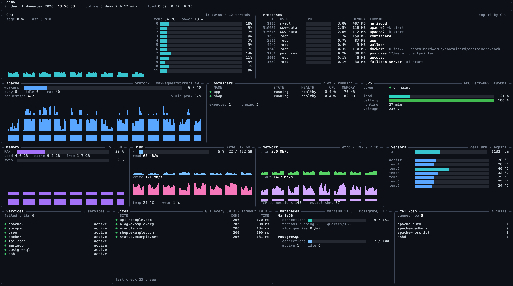
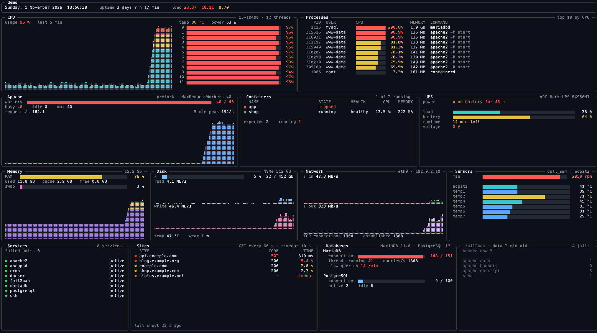
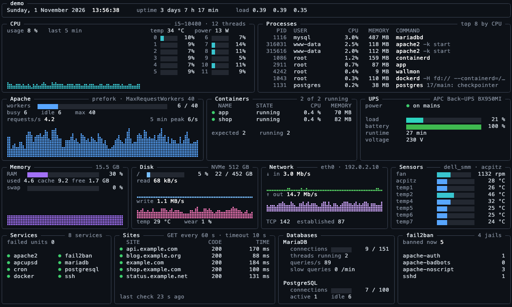
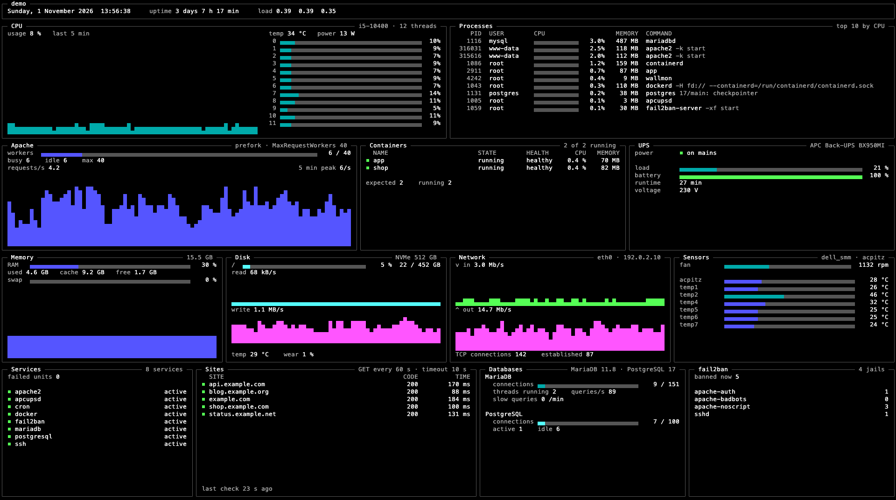
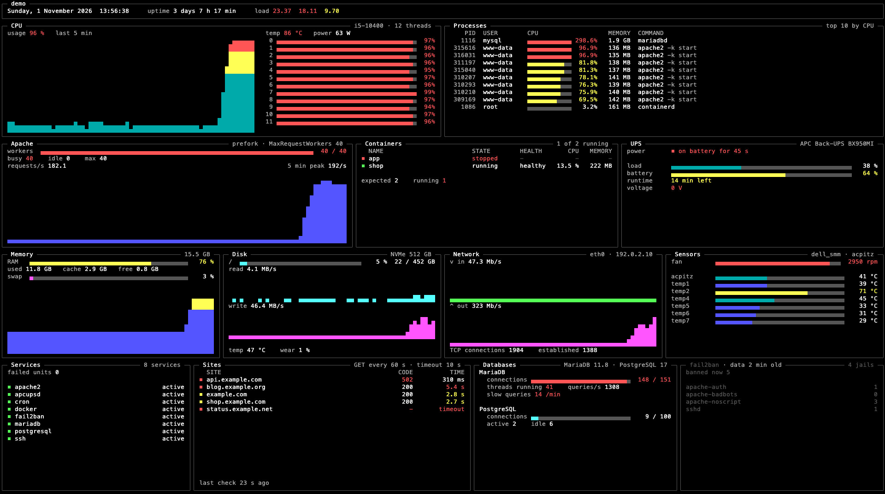

# wallmon

An always-on server status board for a monitor in the server room.



One screen shows everything at once, readable from across the room, with no keyboard needed. There are no tabs, no scrolling and no alarms. Yellow and red mean a problem, and grey means no data. Each panel has its own time limit, so one stuck source never freezes the screen, and stale values are marked with their age. On a smaller terminal the panels get narrower and the lists shorter, but the layout stays the same.

wallmon is a single static binary written in Rust (ratatui + tokio). It runs all day using a fraction of a percent of CPU and a few tens of MB of RAM.

## Panels

| Panel | Source |
|---|---|
| Header: host, uptime, load | `/proc/uptime`, `/proc/loadavg` |
| CPU: usage, temperature, power | `/proc/stat`, hwmon, Intel RAPL |
| Memory and swap | `/proc/meminfo` |
| Disks: usage, throughput, NVMe temperature, wear | `/proc/diskstats`, hwmon, `smartctl` |
| Network: traffic, TCP connections | `/proc/net` |
| Top processes | `/proc/<pid>` |
| Sensors: fans, board temperatures | hwmon |
| Docker containers: state, health, CPU, memory | Docker Engine API on its unix socket |
| Apache workers and request rate | `mod_status` (`server-status?auto`) |
| MariaDB and PostgreSQL | `mariadb` and `psql` clients on the local socket |
| UPS | apcupsd NIS port |
| systemd services | `systemctl` |
| fail2ban bans per jail | `fail2ban-client` |
| Websites: HTTP status and response time | HTTPS GET to each site |

CPU, memory, disks, network and processes are found automatically. Everything else is drawn only when it is configured.

## Screenshots

An ongoing failure (`--demo=failure`): a stopped container, the UPS on battery, an overloaded Apache and fail2ban not answering.



A 150×45 terminal over SSH: the panels get narrower and the lists shorter, but the layout stays the same.



The plain Linux console is shown under [Console](#console). All screenshots are drawn from demo data with `cargo run --example snapshot -- target/screens.html`.

## Try it

On any machine with Rust (no `/proc` needed):

```sh
cargo run -- --demo
```

`--demo=failure` adds an ongoing failure: a stopped container, the UPS on battery, an overloaded Apache and fail2ban not answering. `--basic` shows how it looks on the plain Linux console (see [Console](#console)).

## Configuration

wallmon reads `/etc/wallmon/config.toml` (or the file given with `--config`). Without a file it shows only what it finds by itself. Start from [`config.toml.example`](config.toml.example), which lists every section and option.

## Build

wallmon targets Linux on x86_64 and is built as a static musl binary. With [`cargo-zigbuild`](https://github.com/rust-cross/cargo-zigbuild) it can be cross-compiled from macOS:

```sh
cargo zigbuild --release --target x86_64-unknown-linux-musl
```

`packaging/bundle.sh [config.toml]` builds the binary and packs it with the service and the install scripts into `target/wallmon.tar.gz`.

## Install on the server

Unpack `wallmon.tar.gz` on the server (for example in `/tmp`) and run as root:

```sh
./install.sh
```

It installs:

| File | |
|---|---|
| `/usr/local/sbin/wallmon` | the binary |
| `/etc/wallmon/config.toml` | the configuration, if the bundle has one; an existing file is kept |
| `/etc/systemd/system/wallmon.service` | runs wallmon on tty1 instead of the login prompt |
| `/var/lib/wallmon/uninstall.sh` | removes all of the above |

Then it masks `getty@tty1` and starts `wallmon.service`. Running it again upgrades the binary and the service and keeps the configuration. The unpacked directory is not needed afterwards. Ctrl+Alt+F2 switches to a normal login on tty2.

wallmon runs as root, because Docker, the databases, fail2ban, RAPL and `smartctl` need it.

To remove everything `install.sh` added:

```sh
/var/lib/wallmon/uninstall.sh
```

## Console

wallmon picks one of two looks by itself:

- **Full**: 24-bit colour and braille graphs. Used in [kmscon](https://github.com/Aetf/kmscon) and in terminal emulators, also over SSH.
- **Basic**: 16 colours, square corners, and bars and graphs made of block characters, which every console font has. Used on the plain Linux console (`TERM=linux`). The layout is the same; graphs are coarser. `--basic` forces it anywhere.





### Plain Linux console

This is what `install.sh` sets up, and it needs nothing else. The service ([`packaging/wallmon.service`](packaging/wallmon.service)) runs wallmon directly on tty1:

```ini
[Service]
Environment=TERM=linux
ExecStartPre=-/usr/bin/setterm --blank 0 --powerdown 0
ExecStart=/usr/local/sbin/wallmon
StandardInput=tty
StandardOutput=tty
TTYPath=/dev/tty1
Restart=always
```

`setterm --blank 0` keeps the console from blanking the screen, since nobody touches the keyboard. The number of characters on screen depends on the console font. On Debian and Ubuntu it is set with `dpkg-reconfigure console-setup`; an 8×16 font gives 240×67 characters on a 1920×1080 monitor.

To try it by hand, log in as root on a console (Ctrl+Alt+F2) and run `wallmon`. Ctrl+C quits.

### kmscon (full colour)

kmscon replaces the kernel console on a tty and draws with real fonts, so wallmon gets full colour and braille graphs. The steps below are for Debian 13, where kmscon 10 is in trixie-backports. On other distributions, use their kmscon package or build it from source; the options below are those of kmscon 10.

1. Install kmscon and a font, as root:

   ```sh
   echo 'deb http://deb.debian.org/debian trixie-backports main' >/etc/apt/sources.list.d/trixie-backports.list
   apt update
   apt install -t trixie-backports kmscon fonts-dejavu-core
   ```

2. Create `/etc/systemd/system/wallmon.service.d/kmscon.conf`, which starts wallmon inside kmscon on tty1:

   ```ini
   [Service]
   Environment=TERM=xterm-256color COLORTERM=truecolor
   ExecStartPre=
   ExecStart=
   ExecStart=/usr/bin/kmscon --vt=tty1 --no-switchvt --oneshot --no-reset-env --dpms-timeout=0 \
       --no-mouse --no-blink --session-max=1 "--font-name=DejaVu Sans Mono" --font-size=16 \
       --login -- /usr/local/sbin/wallmon
   StandardInput=null
   StandardOutput=journal
   ```

3. Restart the service:

   ```sh
   systemctl daemon-reload
   systemctl restart wallmon.service
   ```

What the kmscon options do:

- `--dpms-timeout=0`: kmscon would otherwise turn the screen off after 10 minutes without input.
- `--no-reset-env`: wallmon gets `PATH` and `COLORTERM` from systemd, so it finds `mariadb`, `setpriv` and the like, and uses full colour.
- `--oneshot`: kmscon exits together with wallmon, and systemd starts both again.
- `--font-size=16`: DejaVu Sans Mono at 16 px gives 8×16 cells, 240×67 characters on 1920×1080.

The empty `ExecStart=` and `ExecStartPre=` lines clear the commands of the plain console service. The drop-in is kept when `install.sh` upgrades wallmon, and `uninstall.sh` removes it. To go back to the plain console, delete `kmscon.conf`, then run `systemctl daemon-reload` and `systemctl restart wallmon.service`.

## License

[MIT](LICENSE)
