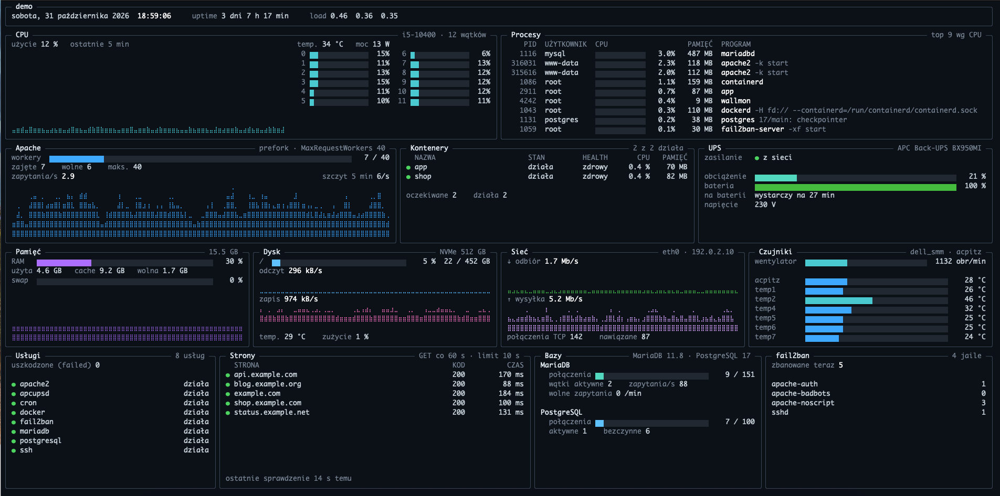

# wallmon

An always-on server status board for a monitor in the server room.



One screen shows everything at once, readable from across the room, with no keyboard needed. There are no tabs, no scrolling and no alarms. Yellow and red mean a problem, and grey means no data. Each panel has its own time limit, so one stuck source never freezes the screen, and stale values are marked with their age. On a smaller terminal the panels get narrower and the lists shorter, but the layout stays the same.

wallmon is a single static binary written in Rust (ratatui + tokio). It runs all day using a fraction of a percent of CPU and a few tens of MB of RAM.

> The on-screen labels are in Polish.

## Panels

| Panel | Source |
|---|---|
| Header: host, uptime, load | `/proc/uptime`, `/proc/loadavg` |
| CPU: usage, temperature, power | `/proc/stat`, hwmon, Intel RAPL |
| Memory and swap | `/proc/meminfo` |
| Disks: usage, throughput, NVMe temperature, wear | `/proc/diskstats`, hwmon, `smartctl` |
| Network: traffic, TCP connections | `/proc/net` |
| Top processes | `/proc/<pid>` |
| Sensors: fans, board temperatures | hwmon |
| Docker containers: state, health, CPU, memory | Docker Engine API on its unix socket |
| Apache workers and request rate | `mod_status` (`server-status?auto`) |
| MariaDB and PostgreSQL | `mariadb` and `psql` clients on the local socket |
| UPS | apcupsd NIS port |
| systemd services | `systemctl` |
| fail2ban bans per jail | `fail2ban-client` |
| Websites: HTTP status and response time | HTTPS GET to each site |

CPU, memory, disks, network and processes are found automatically. Everything else is drawn only when it is configured.

## Try it

On any machine with Rust (no `/proc` needed):

```sh
cargo run -- --demo
```

`--demo=failure` adds an ongoing failure: a stopped container, the UPS on battery, an overloaded Apache and fail2ban not answering.

## Configuration

wallmon reads `/etc/wallmon/config.toml` (or the file given with `--config`). Without a file it shows only what it finds by itself. Start from [`config.toml.example`](config.toml.example), which lists every section and option.

## Build

wallmon targets Linux on x86_64 and is built as a static musl binary. With [`cargo-zigbuild`](https://github.com/rust-cross/cargo-zigbuild) it can be cross-compiled from macOS:

```sh
cargo zigbuild --release --target x86_64-unknown-linux-musl
```

`packaging/bundle.sh [config.toml]` builds the binary and packs it with the service and the install scripts into `target/wallmon.tar.gz`.

## Install on the server

The bundle replaces the login prompt on tty1 with wallmon running in [kmscon](https://github.com/Aetf/kmscon), which gives full colour and braille graphs on the console. Unpack `wallmon.tar.gz` on the server and run as root:

```sh
./install.sh
```

It installs kmscon (from trixie-backports on Debian 13) if it is missing, copies the binary, the systemd service and the configuration, masks `getty@tty1` and starts `wallmon.service`. Running it again upgrades the binary and keeps the existing configuration. Ctrl+Alt+F2 switches to a normal login on tty2.

wallmon runs as root, because Docker, the databases, fail2ban, RAPL and `smartctl` need it.

To remove everything `install.sh` added, including kmscon and the packages that came with it:

```sh
/var/lib/wallmon/uninstall.sh
```

## License

[MIT](LICENSE)
